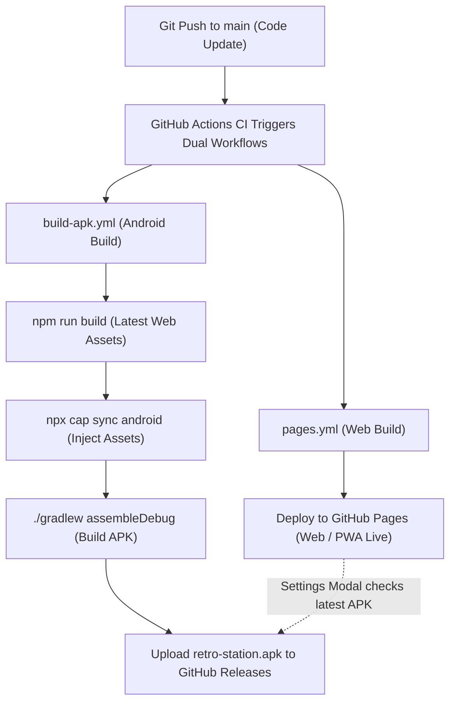

# Plan 004: Option A (Capacitor) + Synchronized Web & APK Auto-Updates

## Goal Description
Add Android APK build support using Capacitor (`@capacitor/core`, `@capacitor/android`, `@capacitor/cli`) with automated GitHub Actions CI, while guaranteeing that:
1. **The web version continues working 100% identically** on GitHub Pages, mobile browsers, and desktop.
2. **Every update to the web version automatically produces an updated APK** via GitHub Actions in lockstep.

---

## Direct Answers to Questions

### 1. Will the web version still work?
**Yes, 100%**.
- Capacitor is purely a runtime wrapper shell; it does not change Vite, React, Tailwind, or browser compatibility.
- `npm run dev` and `npm run build` continue to produce the exact same `dist/index.html` PWA bundle.
- Deployment to GitHub Pages continues without interruption.
- When running in Chrome/Safari/Firefox, Capacitor code is inert.

### 2. When I update the web version, will it update the APK?
**Yes, via Synchronized GitHub Actions CI**:
- Whenever you push an update to `main`:
  1. `.github/workflows/pages.yml` deploys the updated web version to GitHub Pages.
  2. `.github/workflows/build-apk.yml` triggers simultaneously, runs `npm run build`, syncs the updated web assets into the Android wrapper, and compiles the updated APK.
- The latest APK is automatically uploaded to GitHub Actions artifacts and GitHub Releases so you can always install or update the APK.
- We also add an **"App Version & Updates"** section in the Settings modal that checks the latest version and notifies you if a new APK build is ready to download.

---

## Architecture Flow



---

## User Review Required

> [!IMPORTANT]
> **Zero Local Setup Burden**:
> You do NOT need to install the heavy Android SDK, Gradle, or Java 17 inside Termux on your phone.
> The Capacitor config and Android project files will live in your repo, and GitHub's cloud runners will handle the heavy compilation.
>
> **Release Artifacts**:
> We will configure the workflow to build a standard, universally installable `debug` APK (no manual signing keystore needed, installs directly on any Android device via file manager).

---

## Proposed Changes

### Component 1: Dependencies & Capacitor Configuration
#### [MODIFY] `package.json`
Add Capacitor dependencies:
```json
"dependencies": {
  "@capacitor/core": "^6.2.0",
  "@capacitor/android": "^6.2.0"
},
"devDependencies": {
  "@capacitor/cli": "^6.2.0"
}
```
Add helper scripts:
- `"cap:sync"`: `"npm run build && npx cap sync android"`

#### [NEW] `capacitor.config.json`
Configure root properties:
```json
{
  "appId": "com.retrostation.app",
  "appName": "Retro Station",
  "webDir": "dist",
  "server": {
    "androidScheme": "https"
  },
  "android": {
    "backgroundColor": "#09090b",
    "allowMixedContent": true
  }
}
```

---

### Component 2: Android Project Files (`android/`)
#### [NEW] `android/app/src/main/AndroidManifest.xml`
Optimized for handheld gaming:
- `android:hardwareAccelerated="true"`
- `android:appCategory="game"` (triggers OS Game Turbo / CPU frequency lock)
- `android:screenOrientation="unspecified"` (responsive sensor rotation)

#### [NEW] `android/app/src/main/java/com/retrostation/app/MainActivity.java`
- Adds `getWindow().addFlags(WindowManager.LayoutParams.FLAG_KEEP_SCREEN_ON)` so screen never sleeps while playing.
- Enables sticky immersive mode to hide navigation gesture bar and prevent accidental exits.

---

### Component 3: GitHub Actions CI Workflows
#### [NEW] `.github/workflows/build-apk.yml`
Dual-build automation:
- Triggers on push to `main`, tags, and manual trigger (`workflow_dispatch`).
- Runs `npm ci` -> `npm run build` -> `npx cap sync android` -> Gradle build.
- Uploads `retro-station.apk` artifact ready for direct install on Android.

---

### Component 4: Web UI Updates
#### [MODIFY] `src/components/modals/SettingsModal.tsx`
Add **"Android APK Edition"** card:
- Displays current app version.
- On Web: provides direct "Download Android APK" button linking to the latest GitHub Actions / Release build.
- On Android APK: displays "Native Android App • Game Turbo Mode Enabled".

#### [MODIFY] `src/App.tsx`
- Add native hardware back-button listener for Capacitor:
  - When playing a game: Back button opens the in-game menu instead of closing the app.
  - When in home/modals: Back button closes open modal.

---

## Verification Plan

### Automated Tests
1. `npm test` - Verify all 26 existing unit tests pass.
2. `npm run build` - Verify web singlefile bundle compiles cleanly without errors or bundle bloat.

### Manual Verification
1. Run local web preview: verify web version loads, plays ROMs, and opens all modals identically.
2. In Settings modal: verify "Download Android APK" section renders responsively with clear actions.
3. Push to `main`: observe both `pages.yml` (web) and `build-apk.yml` (APK) succeed in GitHub Actions.
4. Download the generated `.apk` and install on an Android device: confirm Game Turbo detection, fullscreen immersion, and offline gameplay.
