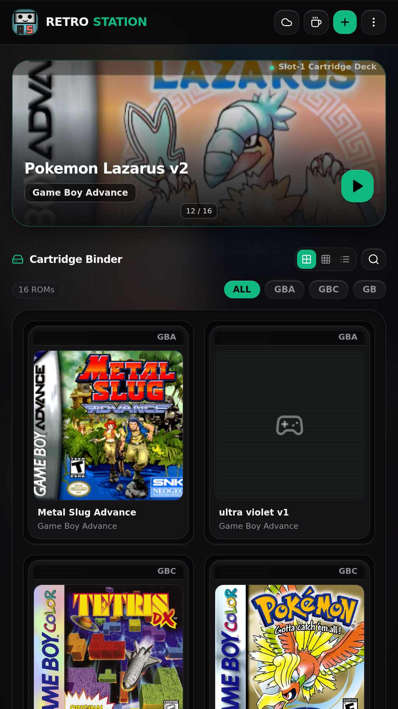
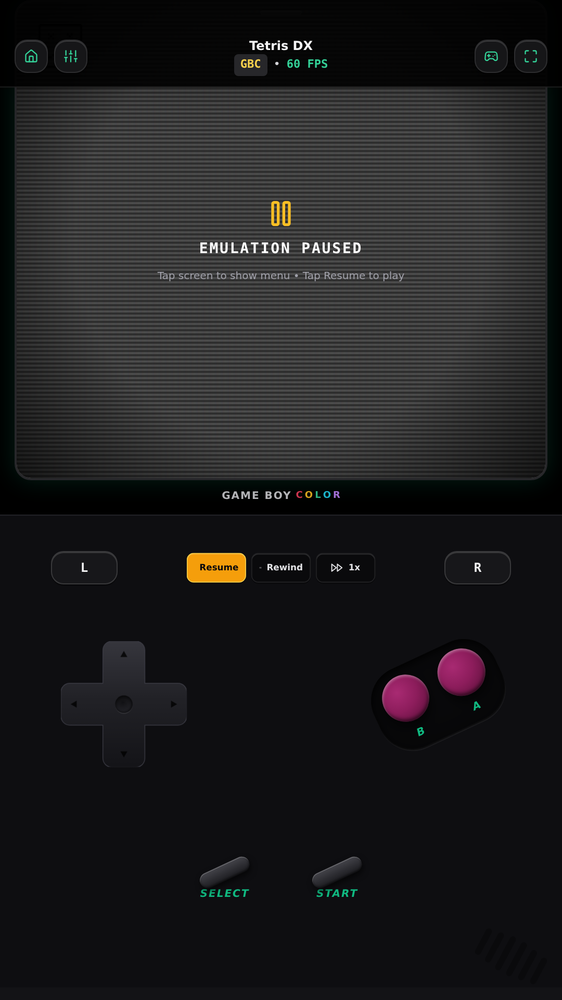
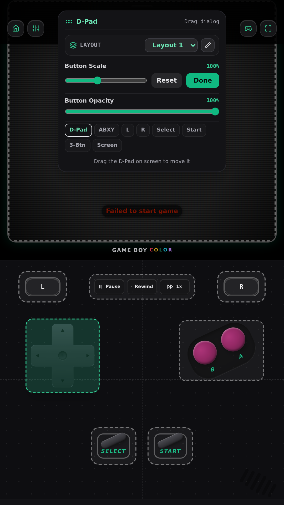
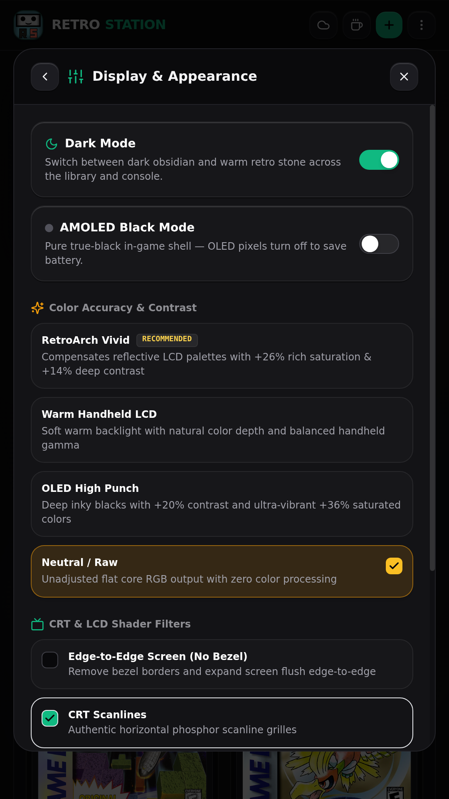
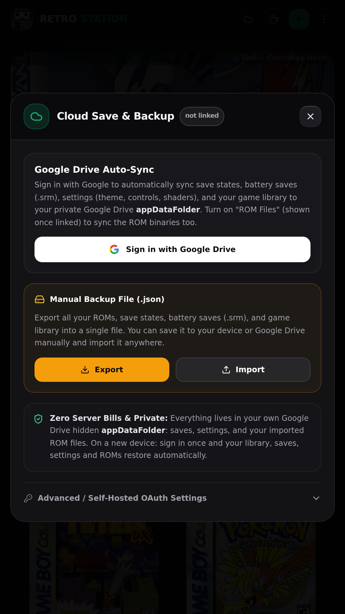
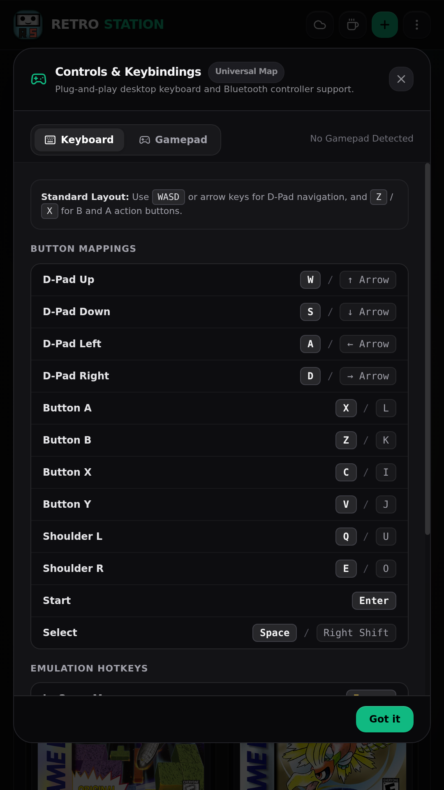
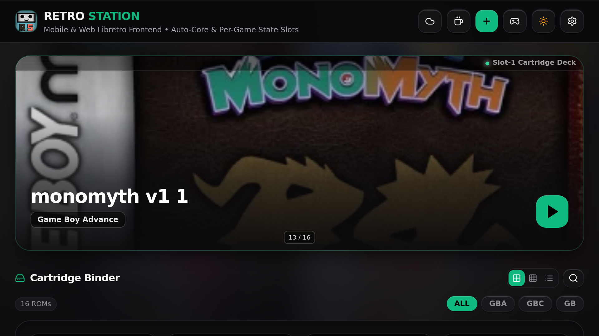

# Retro Pocket (Retro Station)

[](https://kurixutian.github.io/retro-station/)
[](https://github.com/kurixutian/retro-station/releases/latest)
[](https://buymeacoffee.com/kurixutian)

A tactile, offline-first mobile & web Libretro handheld emulator frontend with automatic core detection, per-game save state slots, customizable on-screen touch controls, CRT/LCD hardware shaders, and private zero-cost Google Drive cloud sync.

## Play Now

- **Play in your browser:** [https://kurixutian.github.io/retro-station/](https://kurixutian.github.io/retro-station/)
- **Install the Android App (APK):** [Download v1.1.3 from GitHub Releases](https://github.com/kurixutian/retro-station/releases/latest) — install the native app so your ROMs and saves are stored on your device instead of depending on browser local storage.

### What's New in v1.1.3
- **Updated App & PWA Icon**: Replaced all legacy icons across the web app, PWA manifest, and Android adaptive/round launchers with the updated Retro Station icon.

### What's New in v1.1.2
- **New Minimalist App & PWA Icon**: Replaced all legacy icons across the web app, PWA manifest, and Android adaptive/round launchers with the new black-and-white Retro Station icon.

### What's New in v1.1.1
- **Draggable Menu & Control Customizer Fixes**: Menu button is draggable in portrait and slides horizontally along the bottom edge in landscape; Start/Select and L/R resize together, 3-button transport bar scales down to 35%, and the Edit Controls `Done` button fits cleanly inside the dialog.
- **Reliable Downloads & Full Backup Export**: Patched ROMs and full-library backups stream directly to Android `Downloads` (without crashing on large libraries) and support `Choose Folder…` via the system file picker.
- **Rename & Release Toast**: Fixed cover/sync issues when renaming cartridges and added a non-blocking update toast when a new GitHub release is available.

### What's New in v1.1.0
- **Cartridge Insertion Animation**: Custom cartridge plug-in animation with the selected game's cover art replaces raw loading/decompression screens.
- **Compact In-Game Menu**: Icon-only Menu trigger fixed at the bottom-left with a drop-up quick menu (`Home`, `Config Dialog`, `Edit Buttons`, `Hide/Show Buttons`, `Full Screen`).
- **Fixed Fullscreen & Carousel Sync**: Improved cross-browser Fullscreen toggle and instant featured hero dot indicator sync while swiping.
- **Cleaner Fallback Covers & Modular Services**: Removed overlapping text/badges from missing-boxart placeholders and split cloud sync, D-pad, and layout state into dedicated modules.

## Screenshots

| Cartridge Binder (Portrait) | Pause Menu & Save States | Edit Touch Controls |
| :---: | :---: | :---: |
|  |  |  |

| Display & Shaders | Cloud Save Vault | Controls & Keybindings |
| :---: | :---: | :---: |
|  |  |  |

**Landscape Mode:**



## Features

- **Multi-System Libretro Cores**: Automatic core matching for Game Boy (`.gb`), Game Boy Color (`.gbc`), Game Boy Advance (`.gba`), NES (`.nes`), Super Nintendo (`.sfc`/`.smc`), and Sega Genesis / Mega Drive (`.md`/`.gen`).
- **Tactile Cartridge Binder & Slot-1 Deck**: Physical cartridge shelf with automatic Libretro boxart resolution, quick cartridge swapping, and 4 isolated save state slots per game.
- **Hardware-Style Touch & Controller Input**: Zero-drop sliding D-pad, customizable & scalable portrait/landscape control layouts (3 saved slots per orientation), haptic feedback, and plug-and-play Bluetooth/USB Gamepad & Keyboard support.
- **CRT & Handheld Shaders**: Combinable scanlines, Game Boy dot-matrix LCD grid, RGB phosphor bloom, Trinitron curved bezel vignette, color accuracy profiles, and true-black AMOLED battery saver mode.
- **Private Cloud Vault & Offline Backups**: Synchronize save states, SRAM battery saves (`.sav` / `.srm`), and library metadata directly to your personal Google Drive `appDataFolder`, or export/restore a single offline `.json` backup file anytime.
- **Flasher-Ready Battery Exports**: Export raw `.sav` (GB Operator / FlashGBX) or `.srm` (RetroArch) battery RAM directly from any cartridge.

## Local Development

```bash
npm install
npm run dev
```

### Build Single-File Production Bundle

```bash
npm run build
npm test
```

## Support the Project

If you enjoy using **Retro Pocket**, consider supporting its development:

[](https://buymeacoffee.com/kurixutian)

- **Buy Me a Coffee:** [https://buymeacoffee.com/kurixutian](https://buymeacoffee.com/kurixutian)


## License & Legal

- **Copyright:** Copyright (c) 2026 `kurixutian`. All rights reserved. Unauthorized copying, redistribution, rebranding, or plagiarism of this project's source code, UI, or assets without explicit permission is prohibited.
- **No Copyrighted Content Included:** Retro Pocket is a frontend only. It does **not** include, host, or distribute any copyrighted game ROMs or BIOS files. Users are solely responsible for supplying their own legally obtained game backups.
- **Third-Party Licenses:** Libretro cores, Capacitor, React, and other open-source libraries used by this project remain subject to their respective open-source licenses.
