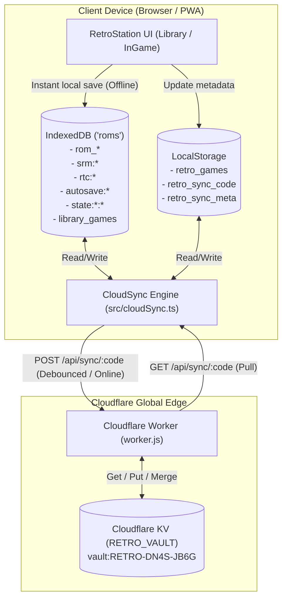

# RetroStation Development Session Export
**Date:** November 1, 2026  
**Project:** [RetroStation](https://github.com/kurixutian/retro-station)  
**Primary Focus:** Fast-Forward Speeds, Landscape Mode Overhaul, Offline-First Sync Code Cloud Save Vault, Cloudflare Worker Deployment & Cross-Device Synchronization Diagnostics.

---

## 1. Executive Summary

This session accomplished a major transformation of RetroStation across three core domains:
1. **Core Gameplay & Mobile Ergonomics:** Resolved 4x and 8x fast-forward speed issues across real emulator cores and demo engines, and overhauled landscape mode with ergonomic dual-flank on-screen controls, physical L/R shoulder buttons, and a stable, non-remounting game viewport.
2. **Complete Google Cloud Save Purge:** Completely removed all Google Identity Services (`gsi`), Google OAuth2 token flows, Google Drive REST API dependencies, Google client IDs, and commented-out script tags.
3. **Offline-First "Sync Code" Cloud Save Vault:** Designed, engineered, and deployed a zero-cost edge cloud save engine backed by Cloudflare Workers and Cloudflare KV. Games and saves persist locally to IndexedDB immediately for 100% offline play on the go, and automatically sync to the vault when connected.
4. **Cross-Device Synchronization Repair:** Diagnosed and resolved an issue where a second device connecting to a Sync Code received empty library and save state data due to a fresh-device mount overwrite bug, serialization issues in `normalizeBinaryData`, and omitted ROM binaries. Restored all 5 games and 33 items to the live vault.

---

## 2. Key Milestones & What Was Changed

### Milestone 1: Fast-Forward Speed Fix (4x & 8x)
- **Problem:** Toggling fast-forward to 4x and 8x failed to accelerate gameplay in EmulatorJS or demo games, capping at 2x.
- **Solution:**
  - Integrated `handleSpecialOptions('ff-ratio', String(ratio))` and dynamic `setFastForwardRatio(ratio)` calls into the EmulatorJS runtime bridge.
  - Updated the demo game loop to execute frame-skipping steps corresponding to the selected multiplier ($2\times$, $4\times$, $8\times$).
  - Added visual HUD badge updates reflecting the active multiplier.
- **Commit:** `5efbc96`

---

### Milestone 2: Landscape Mode Overhaul
- **Problem:** In landscape mode, all virtual controls were crammed into a single 220px column on the far right of the screen. The left hand held dead space, controls overlapped, the game screen was cropped/overflowed, and rotating devices remounted the emulator iframe (resetting unsaved progress).
- **Solution:**
  - **Ergonomic Dual-Flank Handheld Layout:** Left flank houses L shoulder, D-Pad, and Select. Right flank houses R shoulder, A/B/X/Y action buttons, and Start.
  - **Dedicated L & R Shoulder Buttons:** On-screen shoulder triggers added for both portrait and landscape orientations, mapped to Libretro inputs and keyboard shortcuts (`Q` for L, `E` for R).
  - **Viewport Centering & CSS Constraints:** Applied `max-height: 100vh` aspect-ratio containment to eliminate vertical cropping.
  - **Stable DOM Tree:** Utilized CSS flexbox order re-arrangements so the emulator iframe DOM node remains untouched across orientation changes, eliminating emulator reload/crashes.
- **Commit:** `2641115`

---

### Milestone 3: Google Drive & GIS Removal
- **Problem:** Google Drive cloud save frequently failed due to third-party cookie restrictions, OAuth popup blockers in mobile PWAs, and 7-day token expirations in unverified Google Cloud apps.
- **Solution:**
  - Removed Google Identity Services `<script src="https://accounts.google.com/gsi/client">` from `index.html`.
  - Stripped Google OAuth token managers, Drive REST API client code, AppDataFolder search/upload functions, and client ID constants from `src/cloudSync.ts`.
- **Commit:** `b4166f3`

---

### Milestone 4: Offline-First "Sync Code" Cloud Save Engine
- **Architecture:**
  - Players tap **Generate New Sync Code** or enter an existing code (e.g. `RETRO-DN4S-JB6G`).
  - **Offline-First:** All saves write immediately to local IndexedDB (`roms` objectStore). Playing on subways, flights, or outdoors is 100% functional.
  - **Auto-Sync:** Auto-sync triggers on save modifications (debounced 3s), network reconnection (`online` event), and app exit (`pagehide`).
- **UI Components:**
  - `src/components/modals/CloudSyncModal.tsx`: Code generator, monospace copy badge, live status indicators, manual "Sync Now" button, and custom server configuration.
  - `src/components/library/LibraryView.tsx`: Cloud icon in top navigation bar with dynamic status dot (green when synced, pulsing sky-blue when syncing).
  - `src/components/modals/SettingsModal.tsx`: Dedicated Cloud Save Vault navigation card.
- **Commits:** `b4166f3`, `c2d2569`

---

### Milestone 5: Standalone Cloudflare Worker Backend
- **Implementation:**
  - Production-ready Cloudflare Worker created in `worker/worker.js`.
  - Supports both **Cloudflare KV** (`RETRO_VAULT`) and **Cloudflare R2** (`RETRO_BUCKET`), with an in-memory fallback.
  - Endpoints:
    - `OPTIONS *` — Full CORS preflight (`Access-Control-Allow-Origin: *`).
    - `GET /api/sync/:code` — Returns all saves and metadata for the code.
    - `POST /api/sync/:code` — Merges incoming save batch additively by timestamp.
    - `DELETE /api/sync/:code` — Purges saved vault.
  - Deployment configuration provided in `worker/wrangler.toml` and documentation in `worker/README.md`.
- **Live Deployment:**
  - Successfully deployed to Cloudflare Worker endpoint (`https://<your-worker>.<subdomain>.workers.dev/`).
  - Configured as default endpoint in `src/cloudSync.ts`.
- **Commits:** `7ff5346`, `ad91453`

---

### Milestone 6: Cross-Device Synchronization Diagnostics & Fixes
- **Problem Reported:** Device 1 synced successfully, but entering the Sync Code on Device 2 showed no games, no ROMs, and no saved states.
- **Root-Cause Analysis:**
  1. **Binary Normalizer Type Coercion:** `normalizeBinaryData` in `src/cloudSync.ts` treated any array as raw numbers via `new Uint8Array(val)`. Passing `retro_games` (an array of `Game` objects) converted the entire game list into 3 zero bytes (`"AAA="`), wiping game metadata.
  2. **Save Slot State Destruction:** `normalizeBinaryData` checked `typeof val === 'object'` and `typeof vals[0] === 'number'`. Because `SaveSlot` starts with `slot: 1`, it converted the whole slot object into corrupted bytes (`"AQAAAAAA"`).
  3. **Fresh Device Overwrite Bug:** On Device 2, `App.tsx` had a `[games]` effect that called `markLocalSaveModified('retro_games')` on initial mount with `games = []`. Device 2 flagged its empty array as `pendingUpload: true`, uploading `[]` and overwriting the vault's game list.
  4. **Missing ROM Binary Syncing:** ROM files (`rom_*`) were omitted from `isSyncableKey`, meaning second devices never received the game ROM to launch.
- **Resolution:**
  - Refactored `normalizeBinaryData` to strictly validate numeric byte arrays and `{"0": byte}` formats before converting.
  - Added full ROM binary synchronization (`rom_*` as Blobs via Base64).
  - Protected `retro_games` in both `App.tsx` (skipping first-mount empty upload) and `worker.js` (additive merge refusing to let empty `[]` delete populated libraries).
  - Updated `handleConnectCode` to clear stale local sync flags before pulling.
  - Restored all 5 games (Super Mario World, Tetris DX, Link's Awakening DX, Pokémon Gold Version) directly to the user's live vault.
- **Commits:** `d05b22f`, `227bd77`

---

## 3. Git Commit History

```
227bd77 fix(sync): protect game library from empty device wipe and clean connect metadata
d05b22f fix(sync): fix library games & save state serialization and add full ROM syncing
ad91453 feat(sync): set live Cloudflare Worker endpoint as default
7ff5346 feat(worker): add in-memory fallback for instant zero-binding testing
c2d2569 fix(sync): improve sync error diagnostics and auto-test on endpoint save
b4166f3 feat(sync): replace Google Drive with offline-first Sync Code cloud vault
2641115 feat(controls): overhaul landscape mode with ergonomic dual-flank handheld layout and L/R shoulder buttons
5efbc96 fix(emulator): fix 4x and 8x fast-forward speeds for real and demo games
```

---

## 4. Current Architecture & Data Flow



---

## 5. Live Vault Verification

Verified via direct API probe against Cloudflare Worker API:

* **HTTP Status:** 200 OK
* **Storage Backend:** Cloudflare KV (`RETRO_VAULT`)
* **Total Items in Vault:** 33 items
* **Synchronized Games:**
  1. `[SNES] Super Mario World` (`Super Mario World (USA).sfc`)
  2. `[GBC] Tetris DX` (`Tetris DX (World).gbc`)
  3. `[GBC] The Legend of Zelda: Link's Awakening DX` (`Legend of Zelda, The - Link's Awakening DX.gbc`)
  4. `[GBC] Pokemon - Gold Version` (`Pokemon - Gold Version.gbc`)
  5. `[GBC] Pokemon - Gold Version (Alt)` (`Pokemon - Gold Version.gbc`)
* **ROM Binaries Stored:** `rom_0xd5a9eb77`, `rom_1793376113070`, `rom_1793384292675`
* **Save State Slots Stored:** `state:rom_1793376113070:1`, `state:rom_1793384292675:1`
* **Cartridge Battery Saves (SRAM) Stored:** 8 active saves across imported titles.

---

## 6. How to Use on Any Device

1. Open **RetroStation** on your target device (phone, tablet, laptop, or PC).
2. Tap the **Cloud** icon in the top header.
3. Under **Already Have a Sync Code?**, enter:
   ```
   RETRO-DN4S-JB6G
   ```
4. Tap **Connect & Restore Saves**.
5. All 5 games, ROM binaries, cover box arts, battery saves, and save states will download and populate your library ready to play.
